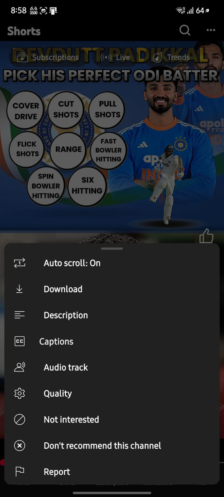
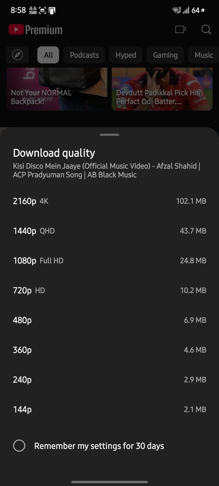
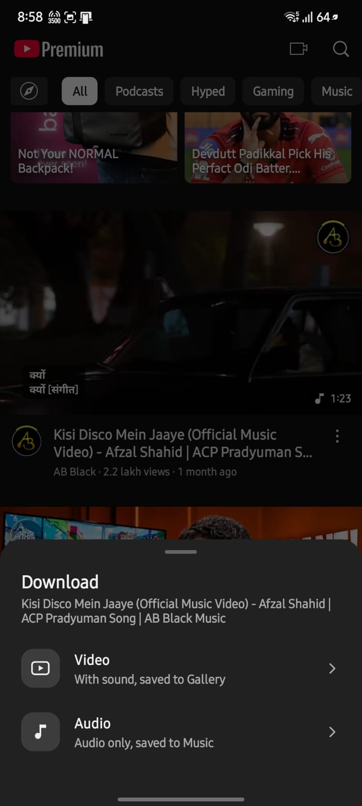
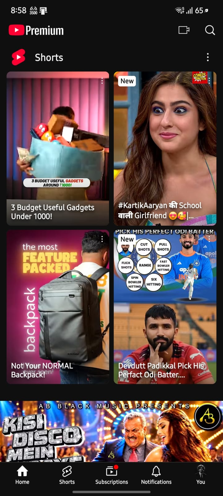

<p align="center">
  
</p>

<h1 align="center">YouTube Ultra</h1>

<p align="center">
  YouTube for Android without ads, with built-in downloads, SponsorBlock and Shorts auto scroll.<br>
  <a href="https://github.com/chinmays-tanx09/youtube-ultra/releases/latest"><b>Download the latest release</b></a>
</p>

<p align="center">
  
  
  
  
</p>

## Features

- **No ads**: no video ads and no feed ads.
- **Downloads**: download any video in any quality from 144p to 4K, or audio only. Fast multi-connection downloads that keep full speed in the background or with the screen off, and paused downloads resume where they stopped. Finished files show up in your Gallery or Music. There's an In progress / Downloaded list inside YouTube's Downloads tab.
- **Shorts auto scroll**: in the Shorts ⋮ menu, turn on "Auto scroll" and the next Short plays when one ends. Turn it off and Shorts loop like normal. Your choice is saved.
- **Cleaner Shorts menu**: "Send feedback" is removed.
- **No time reminders**: no "Take a break" or bedtime reminders, and no "Video paused. Continue watching?" pause.
- **Background play and picture-in-picture**: keep listening with the screen off or in another app.
- **SponsorBlock**: skips sponsor segments automatically.
- **Return YouTube Dislike**: dislike counts are back.
- **Swipe controls** for brightness and volume, a miniplayer, and many layout options in Settings.
- **WhatsApp channel card**: once per app start, an invite to the Paradox WhatsApp channel (Join channel / Later / Don't show again). It waits until MicroG is set up and never shows again after "Don't show again" or after you join.
- **Installs next to the regular YouTube app** (package `app.paradox.youtube`).

## Install

Needs **Android 8.0 or newer**.

1. **Install MicroG first.** You need it to sign in with your Google account.
   Download **MicroG-RE** from the [latest release](https://github.com/chinmays-tanx09/youtube-ultra/releases/latest): `MicroG-RE_7.2.2_arm64-v8a.apk` for most phones, or `MicroG-RE_7.2.2.apk` (universal) if you're not sure.
   Official source: [MorpheApp/MicroG-RE](https://github.com/MorpheApp/MicroG-RE/releases).
2. **Install YouTube Ultra.** Download `YouTube_Ultra_v10.6.apk` from the [latest release](https://github.com/chinmays-tanx09/youtube-ultra/releases/latest) and open it. If Android asks, allow installs from your browser or file manager.
3. **Sign in.** Open YouTube Ultra, tap your profile icon, then sign in. MicroG will ask for your Google account.

You can watch without signing in. Without MicroG, YouTube Ultra still works signed out and shows a "MicroG needed to sign in" sheet.

**Updating:** install the new APK over the old one. Your settings and downloads are kept.

**"App not installed" error?** You probably have a copy signed by someone else. Uninstall it first, then install the official APK from this page.

## Official builds only

Official builds are signed with the developer's private key, and YouTube Ultra checks its own signature every time it starts. If someone modifies and re-signs it, it shows "Modified copy" and closes. Only releases from this repository's [Releases](https://github.com/chinmays-tanx09/youtube-ultra/releases) page are genuine.

## Source code

YouTube Ultra is open source under the **GPL-3.0** license (see [LICENSE](LICENSE) and [NOTICE](NOTICE)). This repository holds everything that makes YouTube Ultra different from stock YouTube:

| Folder | What's in it |
|---|---|
| [`module/`](module) | The Paradox module, plain Java: the download engine (multi-connection, resumable), the Downloads page, quality picker, MicroG sheet, intro screen and the signature check ([`Guard.java`](module/src/paradox/dl/Guard.java)) |
| [`patches/`](patches) | The smali hooks into YouTube and the anddea extension, plus the manifest/resource edits ([what each one does](patches/README.md)) |
| [`scripts/`](scripts) | The full build: fetch pinned tools, build the module, patch, sign |
| [`branding/`](branding) | Intro animation and MicroG sheet icon (not covered by the GPL, see NOTICE) |

The YouTube app itself is not included. It's Google's, so you supply the stock APK when you build.

## Build from source

You need Linux (or WSL on Windows), **JDK 21**, Python 3, `patch`, `curl`, `zip`/`unzip`, and the **Android SDK** with `platforms;android-35` and `build-tools;35.0.0` (Android Studio installs these; point `ANDROID_HOME` at the SDK). About 3 GB of free disk.

1. Get the stock **YouTube 20.05.46** universal APK (nodpi, `com.google.android.youtube`, versionCode 1552692672).
2. Build:
   ```sh
   git clone https://github.com/chinmays-tanx09/youtube-ultra.git
   cd youtube-ultra
   export ANDROID_HOME=$HOME/Android/Sdk

   # sign with YOUR OWN keystore (create one with: keytool -genkeypair -keystore my.jks -alias me -keyalg RSA -keysize 2048 -validity 10000)
   export ULTRA_KEYSTORE=$PWD/my.jks ULTRA_KEY_ALIAS=me
   read -s ULTRA_STORE_PASS; export ULTRA_STORE_PASS

   scripts/build.sh /path/to/youtube_20.05.46_universal.apk
   ```
   The APK lands in `build/out/YouTube_Ultra.apk`. Without the `ULTRA_*` variables you get an unsigned APK instead.

`scripts/fetch-deps.sh` downloads the pinned tools (Morphe CLI 1.19.1, anddea patches 4.4.0-dev.3, Apktool 3.0.3, smali 2.5.2, jarjar, the Java libraries) into `.deps/` and checks each file's SHA-256. To work on the module alone, open `module/src` in Android Studio or any Java IDE and run `scripts/build-module.sh`.

**Your own build is not the official app.** It's signed with your key, so the signature check will show "Modified copy" unless you put your own certificate's SHA-256 into `Guard.CERT_SHA256`. If you publish a modified version, the GPL lets you, but under the [NOTICE](NOTICE) terms you must give it a different name and package, keep the credits, and not use the YouTube Ultra name, icon or intro.

## License

YouTube Ultra © 2026 Chinmay Shastry, licensed under the [GNU GPL v3.0](LICENSE) with the additional terms in [NOTICE](NOTICE). It's GPL because it bundles GPL code: [NewPipe Extractor](https://github.com/TeamNewPipe/NewPipeExtractor) for downloads and [anddea's patches](https://github.com/anddea/revanced-patches). The "YouTube Ultra" and "Paradox" names, icon and intro aren't licensed for reuse.

Credits: [anddea/revanced-patches](https://github.com/anddea/revanced-patches), [Morphe](https://github.com/MorpheApp), [NewPipe Extractor](https://github.com/TeamNewPipe/NewPipeExtractor), [MicroG RE](https://github.com/MorpheApp/MicroG-RE), jsoup, Mozilla Rhino, Protocol Buffers. Full list in [NOTICE](NOTICE).

YouTube Ultra isn't affiliated with or endorsed by Google or YouTube. YouTube is a trademark of Google LLC. MicroG RE is a separate app by its own developers. It's provided here unchanged from its official release.
